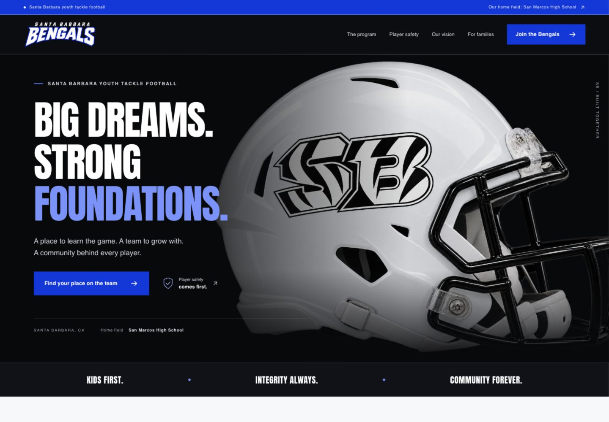

# Santa Barbara Bengals

Youth tackle football in Santa Barbara. A responsive website emphasizing player well-being, local player development, the four-public-high-school representation vision, and the home field at San Marcos High School.

## Website

[Open the Bengals website](https://sbbengals.com/).

Published on sbbengals.com with GitHub Pages from the `main` branch through GitHub Actions. The domain’s website records point to GitHub Pages; Google email records stay with the existing mail provider. Source contains only the website, build files and visual previews. Internal planning documents are not included.

## Run locally

Requires Node.js 24 and npm.

```sh
npm ci
npm run dev
```

## Verify and build

```sh
npm run check
```

The output is in `out/`. `NEXT_PUBLIC_BASE_PATH` configures the GitHub Pages repository path. `NEXT_PUBLIC_SITE_URL` sets the public metadata URL. `NEXT_PUBLIC_INDEXING_ENABLED=true` enables indexing for the public build. The workflow supplies these values and enables indexing for the live domain; none is a secret.

Pull requests run tests, TypeScript, formatting, a production build, and exported-link validation. Pushes to `main` run the same checks and deploy to GitHub Pages only after they pass.

## Family interest

We are taking inquiries for the 2027 season. The linked Google Form saves submitted inquiries to Google Forms and a linked, access-restricted Google Sheet owned by the league administrator. Staff manage response access outside the public repository. Public response summaries are disabled; no response-file links or submitted data belong in this repository.

Fields: parent/guardian or adult contact name, validated email, optional phone, playing/coaching/volunteering interests, player date of birth for player inquiries, and adult confirmation/contact permission. A submitted inquiry is not completed registration or a reserved roster spot. Privacy details are published at `/privacy/`.

The signup button opens the public Google Form in a new tab. The public form is configured in `lib/interest-form.ts`. Google handles submission and displays its saved confirmation. The static site does not process or store form answers itself, and does not collect payments.

## Sponsors and nonprofit

The sponsor page lists Bronze $500, Silver $1,000, and Gold $1,500, as confirmed by the league owner. Sponsor inquiries go to info@sbbengals.com. The 501(c)(3) statement was confirmed by the league owner. No tax ID from a reference organization is used; nonprofit documentation is available by contacting the league.

## Content and assets

The website uses the Santa Barbara Bengals clean full-name wordmark, SB mark, royal blue, black and white, Anton headings and a Helvetica/Arial body stack. Anton is included under the SIL Open Font License in `public/brand/Anton-OFL.txt`. The helmet is an illustration, not a photo of a real player or facility. No third-party team photos or logos were copied.

Program dates, eligibility, fees, credentials and any school partnerships should be updated only with confirmed information. High school choice is a development vision, not an enrollment or athletic eligibility guarantee.

## Preview


