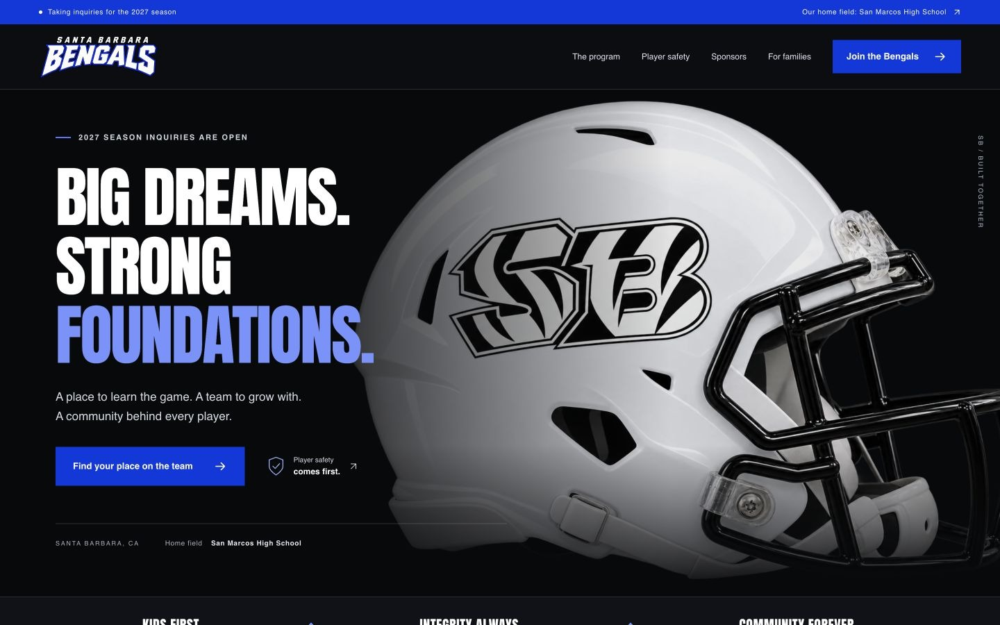

# Santa Barbara Bengals

Youth tackle football in Santa Barbara. A responsive website emphasizing player well-being, local player development across Santa Barbara, Goleta, and Carpinteria, and the home field at San Marcos High School.

## Website

[Open the Bengals website](https://sbbengals.com/).

Published on sbbengals.com with GitHub Pages from the `main` branch through GitHub Actions. The domain’s website records point to GitHub Pages; Google email records stay with the existing mail provider. Source contains only the website, build files and visual previews. Internal planning documents are not included.

## Run locally

Requires Node.js 24 and npm.

```sh
npm ci
npm run dev
```

## Verify and build

```sh
npm run check
```

The output is in `out/`. `NEXT_PUBLIC_BASE_PATH` configures the GitHub Pages repository path. `NEXT_PUBLIC_SITE_URL` sets the public metadata URL. `NEXT_PUBLIC_INDEXING_ENABLED=true` enables indexing for the public build. The workflow supplies these values and enables indexing for the live domain; none is a secret.

Pull requests run TypeScript, formatting, a static build, exported-link validation, and browser checks at phone and desktop widths. Download the `bengals-review` artifact from the pull request’s Actions run to view the screenshots or serve the extracted `out` directory with `python3 -m http.server 4173 --bind 127.0.0.1 --directory out`. The review build disables indexing and the live registration button. Use `NEXT_PUBLIC_REVIEW_BUILD=true npm run check` to produce the same registration behavior locally.

GitHub Pages publishes the live website only from `main` after its build checks pass.

## 2027 registration

The 2027 fee is $495 with no early bird pricing or late registration fees. The
signup button at `/registration/` uses the Bengals club link in `lib/registration.ts`.
Families enter athlete information and complete registration through
PlayMetrics. The website’s privacy page also describes earlier inquiries
submitted through Google Forms.

## Sponsors and nonprofit

The sponsor page lists Bronze $500, Silver $1,000, and Gold $1,500, as confirmed by the league owner. Sponsor inquiries go to info@sbbengals.com. The 501(c)(3) statement was confirmed by the league owner. EIN 43-2243612 was supplied by Brett on November 2, 2026 and is displayed in the nonprofit section. Nonprofit documentation is available by contacting the league.

## Content and assets

The website uses the Santa Barbara Bengals clean full-name wordmark, SB mark, royal blue, black and white, Anton headings and a Helvetica/Arial body stack. Anton is included under the SIL Open Font License in `public/brand/Anton-OFL.txt`. The helmet is an illustration, not a photo of a real player or facility. No third-party team photos or logos were copied.

Program dates, eligibility, fees, credentials and any school partnerships should be updated only with confirmed information. High school choice is a development vision, not an enrollment or athletic eligibility guarantee.

## Preview



## Film room route

`/filmroom/` is an unbranded, full-window embed of the separately hosted public Film Room. It is intentionally absent from team navigation and does not use the team's page layout or branding. The independent host handles video, comments and diagrams; this static wrapper only preserves the requested domain path and validated play-link hashes.
